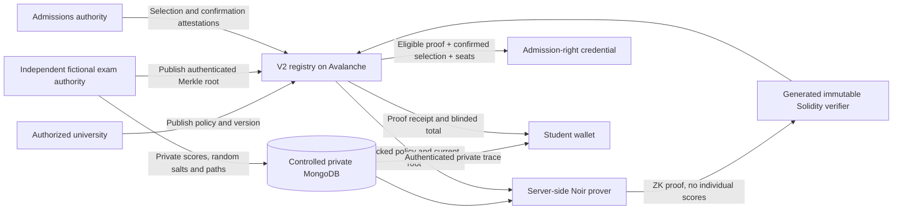

# FairPass private scoring verification

A real Noir zero-knowledge circuit now checks authenticated private exam records against a university's locked scoring policy. A generated Solidity verifier enforces that statement in the v2 registry. The old v1 registry remains available and does not gain ZK guarantees.

**Deployment status:** implemented and exercised on isolated local EVMs. The Fuji v2 deployment is pending approval. No external transactions have been submitted. The existing Fuji contract was inspected using read-only RPC; see [fuji-inspection.json](fuji-inspection.json). It has 9,507 bytes of deployed code and reverts on `protocolVersion()` and `scoringVerifier()`.

## Architecture



The result commitment, scoring claim and admission-right credential are separate records. A non-admitted applicant can receive a verified scoring claim and private explanation without a credential. A scoring proof never mints a right by itself.

## Supported statement

- Exactly three distinct supported examination subjects, on 100-point scales.
- Input scores, weights and minima have at most two decimal places.
- Scores/minima use integer hundredths, in `[0, 10000]`.
- Positive weights use basis points, totaling exactly 10,000.
- The total is `floor((sum(scoreHundredths * weightBasisPoints) + 5000) / 10000)`, in hundredths: half-up rounding once after summation.
- Every selected subject must meet its minimum for eligibility.
- Round 1–4, years 2020–2100, a positive rule version and an eight-level Merkle tree, up to 256 records per authenticated dataset.
- TGAT, TPAT1–5, Mathematics 1, Physics and English use fixed numeric IDs shared by TypeScript and circuit policy inputs.

GPAX, other scales, curriculum conditions, arbitrary formula adapters, special quotas and full TCAS allocation are **not** proved. Unsupported policies are rejected by the API and explained in the v2 rule builder.

## Canonical representations

`backend/shared/zkPolicy.ts` defines subject IDs and supported-policy validation. `backend/src/zk/encoding.ts` defines the canonical protocol encoding.

The authoritative scoring-policy hash is SHA-256 of Solidity ABI encoding of: schema version `uint256(1)`, intake `bytes32`, year `uint32`, capacity `uint32`, round `uint32`, rule version `uint32`, then three fixed arrays `uint32[3]` for subjects, weights and minima. Components are sorted by numeric subject ID. ABI integers are big-endian, 32-byte-padded words. The contract recomputes this hash from the policy it stores; the prover cannot choose it.

The descriptive JSON rulebook retains its existing canonical SHA-256 commitment separately. It includes labels and descriptive metadata. API evidence also checks that the private trace's rulebook matches that published JSON commitment and the authoritative scoring policy. The circuit proves the supported numeric policy; it does not interpret arbitrary JSON or unsupported criteria.

A program version's ID is SHA-256 of ABI encoding `(bytes32 intake, uint32 version)`. A pre-issuance amendment creates another program version and emits an event linking its predecessor. Old versions remain readable and cannot be silently overwritten. Only the current head accepts new proofs/issuance. Amendments after any right has been issued are rejected; start another intake instead. This avoids silently resetting an active seat pool.

### Private exam leaf and Merkle tree

A leaf includes year, exam round, dataset version, both 128-bit halves of the opaque subject, record version, a fresh random field salt, three ordered subject IDs and three integer scores. The authority retains private student-to-subject mappings, salt, leaf index and eight sibling hashes off-chain.

Hashing uses the Noir BN254 Poseidon2 permutation: compression is `permutation([left, right, domain, 3 * 2^64])[0]`. Fixed-length record/policy contexts are folded from a domain seed. Domains 1001/1002/1003/1004 separate exam leaves, tree nodes, nullifiers and blinded totals. Random secrets use cryptographically secure 248-bit nonzero values, below the scalar field modulus. Unused leaf slots are zero; a valid private record must satisfy all nonzero/context/range constraints.

The examination authority publishes a root, year, round, version and expiry. Dataset IDs are immutable. New versions supersede older roots; revocation, expiry, authority deauthorization or a superseding root prevents pending issuance. A fresh proof under a newer current dataset can replace an obsolete claim, with another event. An already issued credential is not automatically revoked by a root update; the authority must apply the credential lifecycle when appropriate.

### Public inputs, in exact order

The contract constructs all 27 public inputs from its own recognized state and the submitted opaque claim. The prover's array is never trusted directly by the registry.

| Indices | Values |
|---|---|
| 0–5 | Chain ID, registry address, authorized root, year, round, dataset version |
| 6–10 | Program ID high/low 128-bit halves, rule version, scoring-policy hash halves |
| 11–14 | Result ID halves, opaque subject halves |
| 15–17 | Scoped nullifier, blinded total commitment, eligibility bit |
| 18–26 | Three subject IDs, three weights and three minima, read from the locked policy |

The nullifier binds chain, registry, year/round, program, rule version/hash and authenticated private leaf. It intentionally excludes the result ID, preventing the same exam record/program/version being claimed again through a different result. The proof itself binds the result ID through the blinded total commitment. Replays, wrong programs/versions/roots/subjects and incompatible verification keys fail.

No individual scores or weighted total are public inputs. The total commitment includes a separate random private blinding salt. The private dashboard opens that commitment and checks its calculated total before showing a verified badge.

## Authorization and trust boundaries

| Layer | Guarantee and remaining trust |
|---|---|
| Cryptographic proof | Authorized dataset membership, subject/context binding, score ranges, exact supported weighted arithmetic, minima and eligibility |
| V2 registry | Authorized rule publication and exam roots; immutable verifier; version/domain/replay checks; proof-gated, confirmed, capacity-limited issuance and existing lifecycle controls |
| Exam authority | Authenticates the underlying scores and real-person-to-opaque-subject binding. The hackathon uses fictional records and a separate signer. The proof cannot establish that an examination authority told the truth. |
| Admissions authority | Authenticates the selection decision and student confirmation. Full allocation, applicant completeness, preferences, tie-breaking and national matching correctness remain **not independently verified**. |
| Private API/prover | Can read fictional private witnesses and identity mappings. Cannot make incorrect supported scoring pass the contract without an authenticated record/proof. Availability, key custody, off-chain identity binding and UI/API delivery are trusted. |
| Public verifier | Reads public credential status; does not receive private score traces, names, preferences, salts or Merkle paths. Holder identity remains unverified. |

The API's issuer and allocation signer must not also hold `EXAM_AUTHORITY`; v2 readiness checks reject that configuration. The exam publication CLI only needs its own signer, RPC/registry and controlled database configuration. Never add its private key to the running API or Vite environment.

This is pseudonymous, not fully anonymous. Existing annual opaque subject bindings, selected programs, eligibility, timestamps and issuance activity remain observable in calldata/storage and can link activity. Scoped nullifiers do not erase that metadata. Production deployment requires a privacy review, secure identity provisioning, independent examination infrastructure, key protection, access controls, recovery/retention policy and security audits of the circuit, framing and integrations. No audit or production readiness is claimed.

## Toolchain

Pinned Noir compiler/executor: `1.0.0-rc.5`. Barretenberg: `5.2.1`. Solidity `0.8.28`, optimizer 200 runs, Shanghai EVM. `verifierTarget: 'evm'` enables zero knowledge; **do not use `evm-no-zk`**. The generated circuit has a 16,384 gate domain and 27 application public inputs. Its Solidity implementation also handles its proof-system pairing accumulator internally.

Two generated libraries, `RelationsLib` and `ZKTranscriptLib`, must be deployed and linked before `HonkVerifier`. The v2 registry takes that verifier as an immutable constructor argument; there is no verifier/key replacement setter. Native binaries and CRS come from the pinned proving package/toolchain. Its proof-system setup and cryptographic assumptions remain part of the trusted computing base.

`npm run zk:build` regenerates the public circuit artifact, VK and Solidity source without writing witnesses. Public circuit artifacts are generated during Docker builds. Witness files, cache fixtures, deployment secrets and raw private input files are excluded from Git and Docker contexts.

## Run the isolated local demo

From the repository root:

```sh
docker compose -f compose.yaml -f compose.zk.yaml up -d --build
docker compose -f compose.yaml -f compose.zk.yaml build tools
docker compose -f compose.yaml -f compose.zk.yaml run --rm --no-deps tools dist/scripts/seed-zk-demo.js
```

Open **http://localhost:8081**. The original demo on port 8080 is separate. `demo-office`, `demo-pim`, `demo-narin` use `password` only in the local fictional demo. Pim has a genuinely verified eligible proof and confirmed issued right. Narin has a genuinely verified ineligible calculation and no right. The institution display is a fictional Kasetsart University example, with no affiliation claimed.

The stack uses separate `fairpass-zk` containers, Mongo/deployment volumes and local chain port 18547. Seeding submits local-chain transactions only, using publicly known local development accounts. It refuses Fuji/mainnet. The independent local exam-authority CLI signs the fictional dataset before API proof generation. Restart/reseed retains the dataset ID and private salts through Mongo; it does not set fake verification flags.

## Build and test

```sh
npm run build:web
npm test
cd backend
npm ci
npm run zk:build
npm run compile
npm run check
npm test
# Browser flows require the test browser:
node_modules/.bin/playwright install chromium
FAIRPASS_BROWSER_TEST=1 FAIRPASS_ZK_BROWSER_TEST=1 npm test
```

`backend/test/zk.test.ts` uses generated proofs and the actual Solidity verifier on an isolated EVM. It covers altered scores, forged witnesses, wrong roots/subjects/programs/rule versions, arithmetic/eligibility errors, unauthorized roots, cross-result replay, a genuine proof from another circuit/key, missing confirmation/proof, ineligibility, duplicates and capacity overflow. API tests cover both student outcomes, access isolation, evidence tampering and public-response/calldata/event privacy. Browser checks click the real proof action and confirm honest evidence states after reload. The existing v1 API/lifecycle suite remains separate and working.

Raw numeric values can occur by chance in cryptographic bytes; privacy tests check decoded public fields and absence of secret data, rather than treating arbitrary matching byte substrings as disclosure. Supported policy parameters are public by design.

## Gas and proof performance

See [MEASUREMENTS.json](MEASUREMENTS.json) for the measured local EVM run. These are **not Fuji receipts or AVAX price quotes**. Deployment costs are separate from ongoing operations. Proof timing includes witness execution, generation and local verification. RSS is a server-process sample, not the combined peak of the native child prover and all services.

Verification and issuance remain separate so every applicant can verify scoring and eligible applicants can wait for official allocation/confirmation. A future combined verification-and-issue call could save a transaction's base overhead for confirmed offers, but it would not help non-admitted applicants; no batching or combined-call gas savings are claimed.

## Files

- `zk/scoring/src/main.nr`, `Nargo.toml`: circuit and source package.
- `backend/contracts/FairPassRegistryV2.sol`: policies, exam roots, proof claims and issuance hook.
- `backend/contracts/ScoringVerifier.sol`: generated real verifier and libraries.
- `backend/contracts/FairPassRegistry.sol`: compatible internal issuance hook; v1 behavior retained.
- `backend/shared/zkPolicy.ts`: common supported-policy validation and subject IDs.
- `backend/src/zk/encoding.ts`, `prover.ts`, `service.ts`, `artifacts.ts`: canonical encoding, private tree/proving, authenticated evidence, verifier linking.
- `backend/src/app.ts`, `chain.ts`, `config.ts`, `store.ts`, `server.ts`: authenticated routes, v1/v2 selection, private storage and prover lifecycle.
- `backend/scripts/build-zk.ts`, `deploy-zk.ts`, `commit-exams.ts`, `seed-zk-demo.ts`: reproducible build, guarded deployment, independent exam root publication and local demo.
- `backend/scripts/compile.ts`, `backend/Dockerfile`, package files: linked artifacts and runtime support.
- `web/src/components/ScoringEvidenceCard.tsx`, `LiveApp.tsx`, domain/API types and scoped CSS: staff/student proof actions, private evidence and issuance gates.
- `backend/test/zk.test.ts`, existing backend test fixes, frontend proof-state checks: regression and end-to-end evidence.
- `compose.zk.yaml`, `docker/init-zk-local.mjs`, ignore files: isolated local infrastructure and private-file exclusions.

See [DEPLOYMENT.md](DEPLOYMENT.md) for Fuji migration requirements. The generated examination-authority wallet is a separate, unfunded signer; no deployment or transaction was performed with it.
